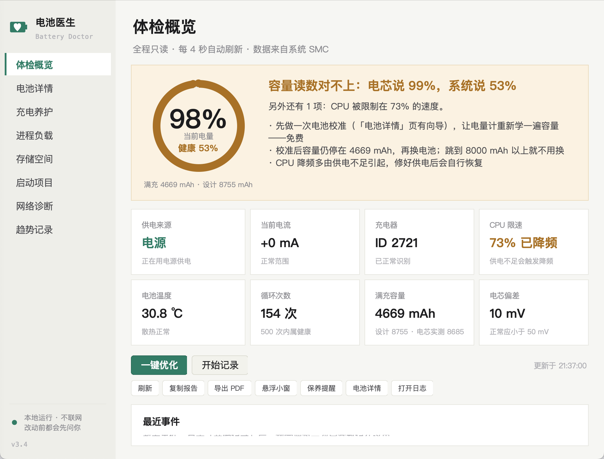
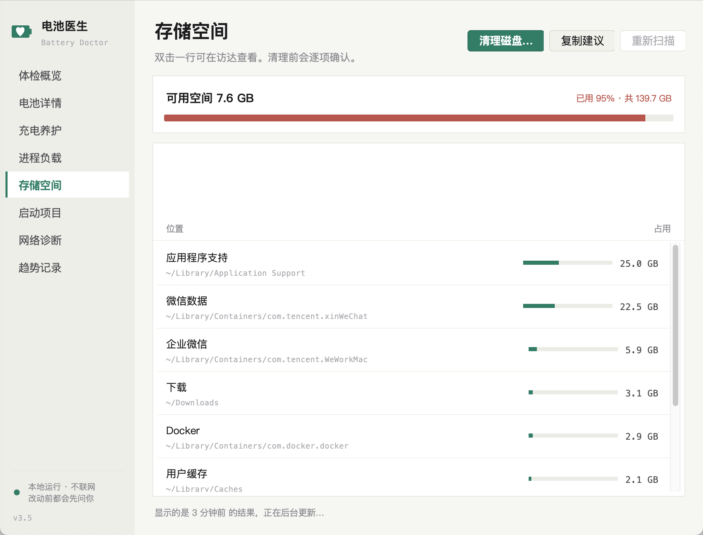

# Battery Doctor

[简体中文](README.md)　·　**English**

> A 2015 MacBook Pro that shut itself down after a while on AC power. Every battery tool on the market gives you readings; none of them answers "what happened in the second before it died". This started as a forensics tool for one broken laptop, and turned out to fit the whole class of "my notebook shuts down for no reason" problems.

**macOS and Windows.** macOS ships as a drag-and-drop dmg with an embedded Python runtime; Windows ships as a single self-contained exe. Neither requires Python or any other dependency. **Everything runs locally. No network.**



---

## What it is for

If your machine does any of the following, this tool produces evidence instead of numbers:

- It powers off under load (compiling, video calls, plugging in an external drive)
- It is plugged in, yet the charge keeps dropping
- It shows 40% remaining, then the screen goes black
- Battery health reads 82%, but you get one hour of runtime

## Three design decisions

**1. Crash forensics**
Every 5 seconds the app appends a power sample to disk, and maintains a heartbeat file plus a "clean shutdown" flag. After a hard power loss and reboot, it can reconstruct the scene: voltage, current, temperature and charging state at the last moment, plus the final 12 samples before the machine went down.

**2. Three-way capacity cross-check**
Most tools report a single "health" number. This one reads three sources at once:

| Field | Meaning | Typical value |
|---|---|---|
| `DesignCapacity` | Factory design capacity | 8755 mAh |
| `AppleRawMaxCapacity` | What the OS currently reports as full charge | 4669 mAh (53%) |
| `Qmax` (per cell) | Capacity the cells themselves learned | 8828 / 8604 / 8623 mAh |

When the OS-reported capacity differs from the cell-reported capacity by ≥25% while cell health is still ≥75%, the verdict is **a miscalibrated fuel gauge, not a dead battery** — so the recommendation is "run a free calibration first, don't buy a battery yet".

**3. Internal resistance from a load step**
Three quiet seconds, then eight seconds at full load on four cores, sampling voltage and current every 300 ms, then ΔV/ΔI gives internal resistance. A battery that cannot hold up under peak power is caught exactly this way — which is the physical cause behind "it shuts down when I start working".

## Features

| Page | What it does |
|---|---|
| Overview | One-line verdict, an ordered action plan, fault codes BD-01 … BD-08 |
| Battery detail | Per-cell balance, internal resistance, cycle count, temperature, adapter negotiation |
| Charge care | Charging habit score + hardware charge limit (SMC BCLM, 80/70/60%) |
| Process load | Who is draining the battery, ranked by energy impact |
| Storage | Directory sizes, low-disk warnings, disk cleanup |
| Startup items | Login items and background agents; disabling only moves them aside |
| App uninstall | Lists installed apps with version, size and last-used; moves them to the Trash (recoverable), optionally with leftover data |
| Network diagnostics | Reachability / DNS / proxy check (the only place that sends a request) |
| History | Sampling curves and runtime estimates |

Also: a one-page repair report (PDF with fault codes and pre-shutdown evidence), one-click optimization, a daily check via launchd, and a floating mini window.




## Privacy: offline by architecture, not by promise

The sampling pipeline has exactly one exit — a CSV file on your own disk. There is no server to upload to, because there is no server.

- The data source is a hardware counter inside the SMC chip, read over I/O Kit, never touching the network stack. Turn off Wi-Fi, enable airplane mode: you still get a timestamped row every 5 seconds.
- The only component that sends anything is the network diagnostics page, and only when you click it: three empty requests, roughly 10 KB total, reading HTTP status codes only.
- Verify it yourself: `lsof -i -p $(pgrep -f BatteryDoctor)` returns nothing, meaning no connection was ever opened.

To keep that true, four things were deliberately left out: silent auto-update (checking for updates requires a click; an optional weekly version check can be enabled), crash reporting, accounts and cloud sync, and usage analytics.

## Quick start

**macOS** — download `BatteryDoctor-x.x.dmg` from [Releases](../../releases), drag the app into Applications, then **right-click it → Open** (the first launch must go through right-click; after that double-click works normally). The dmg includes a "Read me first" guide page. If macOS says the app "can't be opened" or "is damaged", run this in Terminal:

```bash
xattr -dr com.apple.quarantine /Applications/BatteryDoctor.app
```

> This friction exists because Apple notarization requires a $99/year developer account, which this free, open-source, zero-revenue project doesn't have. The trade: two extra clicks on first launch, in exchange for fully auditable code.

**Windows** — download `BatteryDoctor.exe` from [Releases](../../releases) and double-click it. The runtime is embedded; no Python needed. If SmartScreen blocks it, choose "More info → Run anyway".

**Run from source**:

```bash
python3 app/batterydoctor.py
```

**Build the Windows exe yourself** — open `win64/` and run `一键打包.bat` (needs Python 3.9+ on your machine); the result lands in `win64/dist/`. CI uses the same path: pushing a `v*` tag makes GitHub Actions build it on a Windows runner and attach it to the release.

## Building the dmg

```bash
bash build_dmg.sh
# output: build/dist/BatteryDoctor-<version>.dmg
```

The script embeds a Python runtime, so whoever receives the dmg needs nothing installed.

## Repository layout

```
app/batterydoctor.py    main app (~6500 lines, single file: parsing / reasoning / UI)
win64/                  Windows build (bd_core.py data layer + bd_ui.py UI)
build_dmg.sh            macOS dmg packaging
optimize.sh             command-line optimization (no GUI)
powerwatch.sh           pure sampling daemon
index.html              landing page (single file, host it anywhere static)
version.json            update manifest (read by "Check for updates")
tools/stats.sh          download stats (read-only nginx log parse over SSH)
tools/server_stats.py   daily server-side rollup (cron, writes stats.json for the site)
build artifacts         not committed — see .gitignore, distributed via Releases
```

## How download counts work without a backend

There is no analytics code in this project, yet "how many people downloaded it" has had an answer from day one — the installers are served by your own web server, and nginx has been logging every download in `access.log`:

```bash
bash tools/stats.sh        # read-only remote parse: full downloads / range requests / unique IPs
bash tools/stats.sh 7      # only the 7 most recent log files
```

Three different numbers, do not mix them up:

| Metric | Source | Accuracy |
|---|---|---|
| Download count | HTTP 200 responses for `downloads/` in nginx logs | Exact per request (206 range requests counted separately) |
| Downloading users | Unique IPs from the same logs | Order of magnitude only (dynamic IPs inflate it, shared NAT deflates it) |
| **Install / active count** | Unique IPs hitting `version.json` | A lower bound only: just users who enabled the weekly check leave that single request |
| GitHub downloads | Release API `download_count` | Exact, but only counts people who downloaded from GitHub |

An exact install count would require the client to phone home, and phoning home *is* tracking — so this project counts only what the server already knows.

A daily cron on the server (`/etc/cron.d/battery-stats` → `tools/server_stats.py`) accumulates per-day counts into a state file (so history survives log rotation) and writes a same-origin `stats.json`; the landing page renders "downloaded N times" from it. The front end has no third-party script, and hides the block entirely if the file is unreachable.

## Compatibility

- macOS 11 or later, Intel and Apple Silicon both run
- Charge limiting (BCLM) is **Intel-only**; Apple Silicon does not expose that SMC key
- The Windows build reads WMI, so it has no charge limiting or SMC features

## Known limits

A diagnostic tool can localize a fault; it cannot fix hardware. If the BMS or the mainboard power path is damaged, the software can only point at it.

Some directories require Full Disk Access to read. When it cannot read them, the app says "access restricted" instead of pretending everything is clean.

Sampling is one row every 5 seconds, about 1.8 MB per day. Above 40 MB the log is archived automatically, keeping roughly the last 11 days.

## License

MIT — see [LICENSE](LICENSE).
