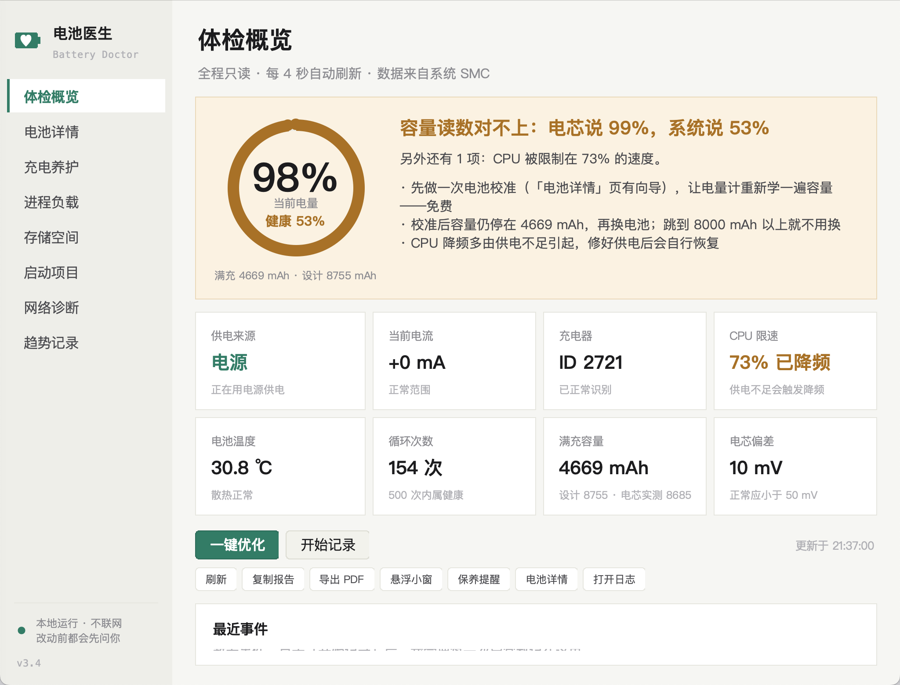
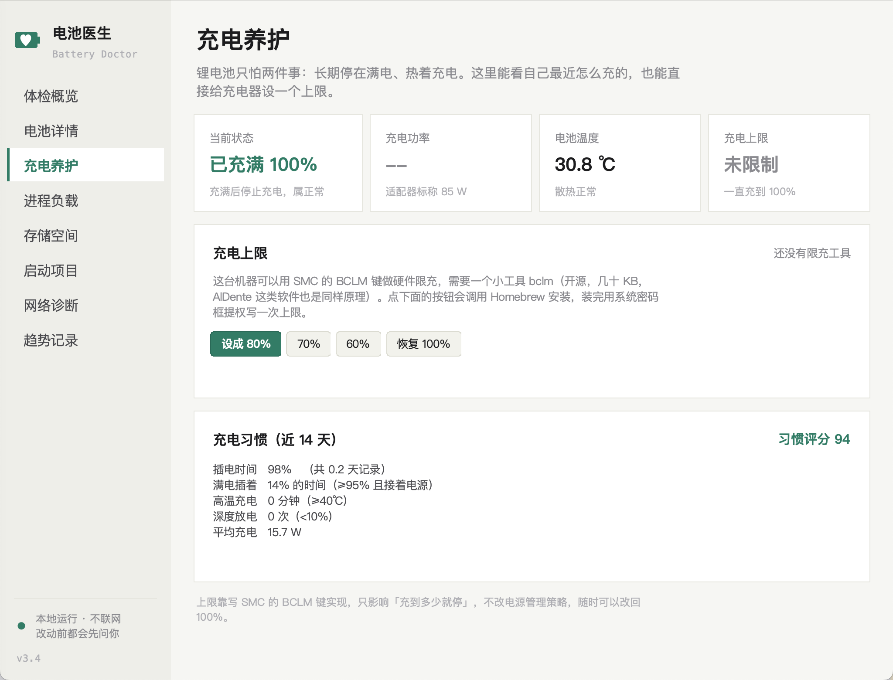
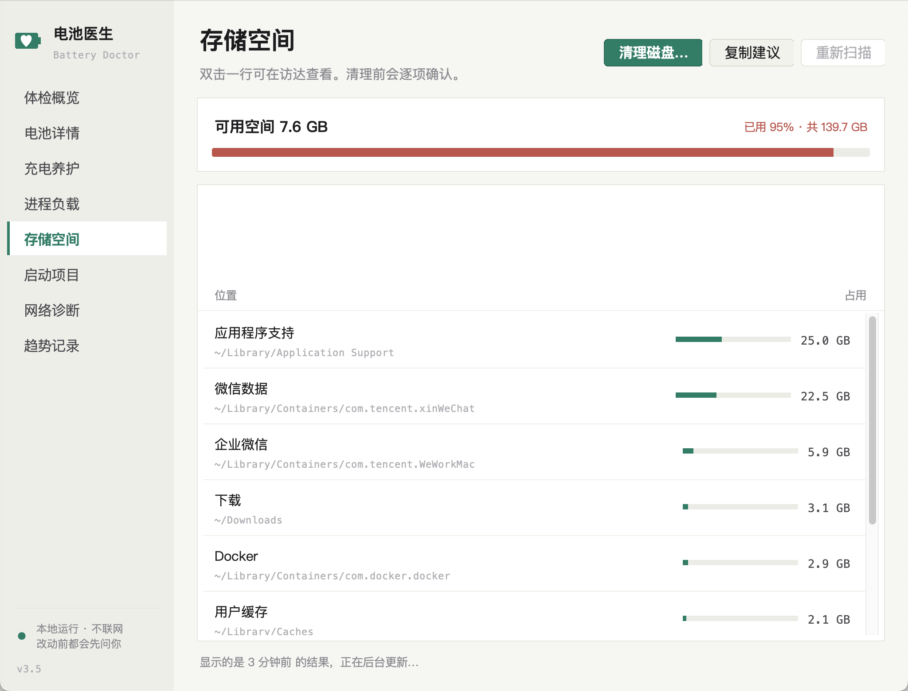

# 电池医生 · Battery Doctor

> 一台 2015 款 MacBook Pro，插着电用一会儿就自己关机。市面上的工具都在给读数，没人回答「关机前那一秒发生了什么」。这个软件最初是给自己做的取证工具，后来发现它对「笔记本莫名关机」这一类问题都适用。

macOS 原生应用（Tkinter + 内嵌 Python 运行时，双击即用），另附 Windows 版源码。**全程本地运行，不联网**。



---

## 它解决的是哪类问题

如果你的电脑出现下面任何一种情况，这个工具能给出证据，而不只是数字：

- 一忙起来就关机（跑编译、开视频会议、插上外接硬盘）
- 插着电源，电量却在往下掉
- 电量显示还有 40%，突然黑屏
- 电池健康度显示 82%，但续航只有一小时

## 三个关键设计

**1. 断电取证**
每 5 秒把供电数据写进磁盘，同时维护心跳文件和「干净退出」标记。机器被强制断电后重启，软件能回到现场：最后一刻的电压、电流、温度、是否在充电、以及断电前 12 条采样。

**2. 三口径容量交叉验证**
一般软件只报一个「健康度」。这里同时读三个来源：

| 口径 | 含义 | 典型值 |
|---|---|---|
| `DesignCapacity` | 出厂设计容量 | 8755 mAh |
| `AppleRawMaxCapacity` | 系统当前报的满充容量 | 4669 mAh（53%） |
| `Qmax`（逐节） | 电芯自己学到的容量 | 8828 / 8604 / 8623 mAh |

当系统报的容量和电芯自报的容量差 ≥25%、而电芯健康度仍 ≥75% 时，判定为**电量计读数失准**，而不是电池报废。结论是「先做一次免费校准，别急着换电池」。

**3. 带载压降测内阻**
安静 3 秒 → 4 核满载 8 秒，期间每 300ms 采样电压电流，用 ΔV/ΔI 算内阻。撑不住峰值功率的电池，就是这样被认出来的——这正是「一忙就关机」的物理原因。

## 功能

| 页面 | 做什么 |
|---|---|
| 体检概览 | 一句话结论 + 处理顺序 + 故障码 BD-01 ~ BD-08 |
| 电池详情 | 逐节电压均衡、内阻、循环、温度、适配器握手功率 |
| 充电养护 | 充电习惯评分 + 硬件限充（SMC BCLM，80/70/60%） |
| 进程负载 | 谁在耗电，按能耗排序 |
| 存储空间 | 各目录占用、磁盘紧张预警、清理磁盘 |
| 启动项目 | 登录项与后台代理，停用只挪走不删除 |
| 网络诊断 | 连通性 / DNS / 代理检测（唯一会发网络请求的地方） |
| 趋势记录 | 采样历史曲线、续航估算 |

另外：一页纸送修单（PDF，含故障码与断电前证据）、一键优化、每日体检（launchd）、悬浮小窗。





## 隐私：不联网是架构决定的

采样通道只有一个出口——你硬盘上的一个 CSV。没有服务器可以上传，因为没有服务器。

- 数据源是 SMC 芯片里的硬件计数器，走 I/O Kit，不经过网卡。拔掉 Wi-Fi、开飞行模式，时间戳照样每 5 秒一条。
- 唯一会发请求的是「网络诊断」页，必须你亲手点，3 个空请求合计约 10 KB，只读 HTTP 状态码。
- 自己验证：`lsof -i -p $(pgrep -f BatteryDoctor)` 返回空，说明它一个连接都没建立。

为了做到这一点，砍掉了四样东西：自动更新、崩溃上报、账号与云同步、使用统计。

## 快速开始

**macOS**：下载 [Releases](../../releases) 里的 dmg，拖进「应用程序」。未公证，首次打开需右键 → 打开。

**从源码运行**：

```bash
python3 app/batterydoctor.py
```

**Windows**：进 `win64/`，双击 `直接运行.bat`（需要 Python 3.9+），或双击 `一键打包.bat` 生成单文件 exe。

## 自己打包 dmg

```bash
bash build_dmg.sh
# 产物：build/dist/BatteryDoctor-<版本>.dmg
```

脚本会把 Python 运行时一起嵌进去，拿到 dmg 的人不需要装任何环境。

## 目录结构

```
app/batterydoctor.py    主程序（约 6500 行，单文件：解析 / 归因 / UI）
win64/                  Windows 版（bd_core.py 数据层 + bd_ui.py 界面）
build_dmg.sh            打包 macOS dmg
optimize.sh             命令行优化脚本（不启动界面）
powerwatch.sh           纯采样守护脚本
index.html              官网（单文件，可直接放任意静态托管）
下载产物不进仓库        见 .gitignore，用 Releases 分发
```

## 兼容性

- macOS 11 及以上，Intel 与 Apple Silicon 均可运行
- 充电上限（BCLM）**仅 Intel 机型支持**，Apple Silicon 的 SMC 不暴露该键
- Windows 版用 WMI 数据源，没有充电上限与 SMC 相关能力

## 已知限制

诊断工具的天花板是定位，修不了硬件。BMS 或主板供电电路坏了，软件只能指出来。

部分目录需要「完全磁盘访问权限」才读得到，否则会明确显示「读取受限」而不是假装很干净。

数据采样每 5 秒一条，长期运行约 1.8 MB/天，超过 40 MB 会自动归档，只保留最近约 11 天。

## 许可

MIT，见 [LICENSE](LICENSE)。
